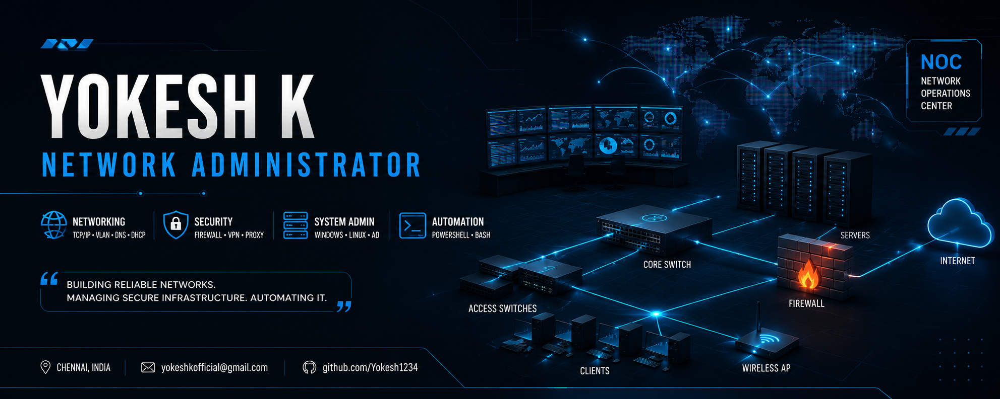

  

## 🛠️ Skills & Technologies

### 🌐 Networking

### 🖥️ Systems & Infrastructure

### 🔥 Security & Network Tools

### ⚙️ Automation & Administration

# 👋 Hi, I'm Yokesh K

### 🌐 Network Administrator | System Administration | IT Infrastructure

I'm a **Network Administrator** passionate about designing, managing, securing, and troubleshooting reliable IT infrastructure and network environments.

### 🛠️ Technical Skills

* 🌐 **Networking:** TCP/IP, DNS, DHCP, VLAN, Routing, Switching, NAT
* 🔥 **Network Security:** Firewall, Proxy, VPN, Access Control
* 🖥️ **System Administration:** Windows Server, Active Directory, Group Policy
* 🐧 **Linux:** Linux Administration, Shell Scripting, Server Management
* 📡 **Network Management:** Monitoring, Troubleshooting, Infrastructure Management
* ⚙️ **Automation:** PowerShell, Bash, IT Automation
* 🧰 **Tools:** Cisco Packet Tracer, pfSense, Squid Proxy, PDQ Deploy, NxFilter
* 💻 **Virtualization:** VirtualBox and Virtual Machine Management

### 🚀 What I Work On

* Network infrastructure & troubleshooting
* Windows/Linux server administration
* Active Directory & user management
* Network security and firewall configuration
* IT infrastructure automation
* System monitoring and maintenance

### 📂 Projects

🔹 Network & Infrastructure Management
🔹 Active Directory Administration
🔹 IT Automation Scripts
🔹 Network Security & Firewall Projects
🔹 Linux Server Projects
🔹 System Administration Tools

### 📫 Connect With Me

I'm always interested in **networking, infrastructure, system administration, cybersecurity, and automation**.

---

⭐ *Building reliable networks. Managing secure infrastructure. Automating IT.*
